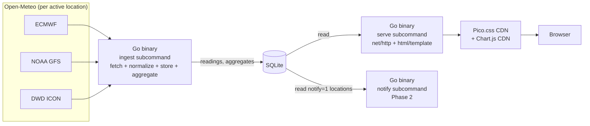

# multiWeatherApp — Project Research & Architecture Decisions

This document records the original idea, the architecture that came out of
it, and the reasoning behind each technology choice. Kept for future-me and
for anyone looking at the reasoning behind the repo.

## 1. Original Plan

> Consolidate weather information from multiple sites/APIs (webscraping
> possibly included), normalize and store it, then compute a daily average
> (or another statistic — median was flagged as worth weighing) across
> sources to get a better week/month prediction. Show the result on a
> simple web view.

Stated constraints going in:
- Keep it simple, efficient, fast.
- No build step, no toolchain required on the deploy device.
- Deploy self-hosted: own PC, or even a phone acting as a server. Speed
  matters because of this.
- Would like to use **C** somewhere — not because the project needs it,
  but for personal enjoyment and as a public GitHub portfolio piece. A
  "forced but wanted" constraint, explicitly flagged as such.
- Open to suggestions on the rest of the stack (candidates floated: C/Go
  backend, Python frontend, Java backend, Python both sides, plain
  JS/HTML frontend).

## 2. Prior Art

Checked whether this has been built before (2026-09-13 web research).
Short answer: yes, multiple times, at very different scales.

| Project | Scale | Approach | Stack |
|---|---|---|---|
| [Consensus_Weather](https://github.com/Szebastian31/Consensus_Weather) | Small | Flat average of 7 national models via Open-Meteo | HTML/JS, no backend, no storage |
| [wx-aggregator](https://github.com/leizmonk/wx-aggregator) | Small | Flat average by ZIP | JS |
| [weather-ensemble-forecaster](https://github.com/Zephyr-Howson/weather-ensemble-forecaster) | Medium | Weights each source by `1 / recent mean absolute error`, reweighted nightly from tracked accuracy | Python, SQLite, scikit-learn, GitHub Actions/Pages |
| [weather-project](https://github.com/aleksgain/weather-project) | Medium | Weighted-median + MAD outlier rejection before averaging; severity-aware voting for conditions; confidence score from source agreement | React, client-side only |
| [open-local-weather](https://github.com/dissent00/open-local-weather) | Large (~476 commits) | Multi-model synthesis, per-lead-time accuracy tracking, self-improving verification loop, air quality/METAR, LLM integration | Python, Dart, git-as-database, serverless on GitHub Actions/Pages |

### Lessons taken from these

1. **Average vs. median — resolved.** Three independent projects hit the
   same problem (a flat mean is fragile when one source misbehaves) and
   solved it three different ways: median, MAD-based outlier rejection,
   or accuracy-based weighting. Decision: **start with median** for v1 —
   robust to outliers by construction, needs no historical data, trivial
   to implement in Go. Revisit accuracy-weighted blending
   (`weather-ensemble-forecaster`'s approach) as a v2 once enough history
   exists to know which sources are actually more accurate at this
   location.
2. **Add a confidence/agreement figure alongside the aggregate.** Cheap —
   it's the spread/std-dev already computed mid-aggregation — and directly
   serves the original goal ("better idea of the prediction"), not just
   the number itself. Seen in `weather-project`'s confidence score and
   `open-local-weather`'s per-lead-time accuracy tracking.
3. **Mistake to avoid**: `weather-project` calls weather APIs directly
   from browser JS, exposing API keys client-side. Not applicable here in
   either half of the original concern — Open-Meteo needs no API key, and
   fetching runs server-side regardless (now in Go, not Python — §5.1).
   Still worth naming: the browser never talks to Open-Meteo directly,
   keeping fetch logic and rate-limit handling in one place.
4. **`open-local-weather` is the "very big project" exception** — not a
   reason to second-guess this project's own shape, just a source of a
   couple of ideas (per-lead-time accuracy tracking, in particular) worth
   remembering if this project grows later.
5. None of the prior-art projects run fetch, aggregate, and serve from a
   single compiled binary the way this one does (they're single-language
   scripts/frameworks, not one static executable end-to-end) — the
   pipeline shape here isn't a duplicate of something existing.

## 3. Proposed Architecture

One Go binary, three subcommands, one SQLite file — no second language,
no second process type.

Pipeline in words:
0. **Trigger — a scheduled job, once daily for v1.** A cron job (or
   platform equivalent — Task Scheduler / Termux alternative, whatever
   the deploy target needs) runs `ingest` at a fixed time, independent of
   whether anyone visits the page. Chosen over on-demand for two reasons:
   simpler to reason about and maintain, and it gives every run a
   *consistent* wall-clock time — fetching only when a visitor happens to
   show up would scatter `fetched_at` across the day, adding noise to
   Phase 2's lead-time accuracy analysis.
1. **Fetch** (`ingest`, Go, `net/http` + `encoding/json`) iterates over
   every `active` row in the `locations` table and queries Open-Meteo per
   location, with `models=` set to the 3 v1 sources (ECMWF, NOAA GFS,
   DWD ICON), for hourly data.
2. **Normalize + store** (same `ingest` run) inserts one row per source
   per hour into `readings`, keyed by `location_id`, via
   `INSERT ... ON CONFLICT DO NOTHING` against the unique constraint
   (§4) so a crashed/retried run stays idempotent.
3. **Aggregate** (same `ingest` run) computes the cross-source median
   per `valid_time` for each active location and writes a new
   `aggregates` row keyed by `(location_id, valid_time, issued_at)` —
   preserving the forecast trajectory rather than collapsing it (§4).
   The same run prunes data past the retention window (§4) before it
   exits.
4. **Serve** (`serve` subcommand, Go, `net/http` + `html/template`) reads
   `readings`/`aggregates` and renders server-side HTML with a Chart.js
   trend graph, no JS build step involved. `serve` never fetches or
   aggregates — purely reads what `ingest` already wrote.
5. **Notify** (`notify` subcommand, Phase 2 — §6.1) reads only locations
   with `notify` set and sends the day's forecast at a human-useful hour,
   independent of `ingest`'s schedule. A separate subcommand from the
   start, not folded into `ingest`, because it's a different job on a
   different cadence.

SQLite sits in the middle as the shared store between the three
subcommands of one binary — no bespoke file format or IPC needed.

### 3.1 Forecast convergence (v1 feature)

Enabled directly by the trajectory-preserving `aggregates` table (§4):
for a given future `valid_time`, show how successive `ingest` runs (each
with its own `issued_at`) shifted the predicted value, and whether the
spread across sources is narrowing or widening as lead time shortens.
Answers "is Saturday's forecast settled or still moving?" — a question
none of the five prior-art projects (§2) answers, and one that needs no
`observations` table and no Phase 2 work. This is the differentiating
feature of v1, not a nice-to-have.

## 4. Database Schema

**v1 assumes a fresh database** — no schema versioning, no migration
path. Five tables: two lookups (`sources`, `conditions`), one dimension
table (`locations`), one fact table (`readings`, hourly, per-source), one
derived table (`aggregates`, cross-source median). Key fields that must
survive normalization intact: **temperature, valid_time, location_id,
humidity**.

Headline decisions:
- **Hourly, not daily.** `valid_time` is a full ISO-8601 timestamp
  (renamed from `valid_date`) — the old schema never said whether its
  one `temperature`/day was max, min or mean, and daily mean humidity is
  meaningless given its diurnal cycle.
- **`locations` replaces inline lat/lon** — fixes a real bug: the old
  `UNIQUE (latitude, longitude, valid_date)` compared REAL floats for
  equality and could silently produce duplicate rows. Append-only, 4
  decimal rounding, per-location IANA timezone, separate `active`/
  `notify` flags.
- **`aggregates` preserves the forecast trajectory**
  (`UNIQUE (location_id, valid_time, issued_at)`, not one row per hour)
  — the most interesting data the project produces, and what enables
  §3.1's forecast-convergence feature.
- **`readings` keys on `issued_at`, not `init_time`** — Open-Meteo's
  Forecast API doesn't expose model-run init time inline (verified
  2026-09-15); tracked as a known limitation in §7.
- **Precipitation and condition are not aggregated by median** — median
  erases the extreme-event signal for precipitation amount, and is
  undefined for a categorical field; both use ensemble-threshold
  derivation instead.
- **Retention: 5 years**, ~184,000 rows/year/location at hourly
  granularity (~18 MB/year/location), pruned by the same `ingest` run.

Full column-by-column SQL, every constraint's rationale, and the
lagged-ensemble/null-handling rules: see
[SCHEMA-ANALYSIS.md](SCHEMA-ANALYSIS.md).

## 5. Technology Decisions

Each section: options considered → pros/cons → decision.

### 5.1 Fetch & Normalize Layer

| Option | Pros | Cons |
|---|---|---|
| **Go** | stdlib `net/http` + `encoding/json` cover this in ~50 lines, zero dependencies; same binary as aggregate/serve, no second runtime on the deploy device | More boilerplate than Python for a *volatile*, multi-provider integration — not the case here |
| Python | Best HTTP/JSON ergonomics; fast to iterate when an API changes or misbehaves | Needs an interpreter; a second runtime alongside the Go binary, for a provider that no longer needs that flexibility |
| C | Fast, no interpreter | HTTP needs libcurl, JSON needs cJSON — boilerplate Go's stdlib avoids |
| Java | Mature HTTP clients | JVM startup/memory overhead conflicts with the self-hosted/low-power goal |

**Decision: Go.** Reversed from Python (2026-09-15, §8). "A scripting
language's iteration speed matters more than runtime overhead" holds for
APIs that are volatile across *multiple* providers with differing auth
and formats — it doesn't hold for one keyless provider with a stable,
documented schema. `net/http` + `encoding/json`, both stdlib, cover
fetch + normalize without adding a second language and a second runtime
to the deploy target. Python isn't deleted from the project — see §6.2
for its new, off-device role.

**Source for v1: Open-Meteo only, 3 named models, no scraping, no
site-discovery step.** None of the prior-art projects in §2 needed web
scraping. Open-Meteo takes a lat/lon and can return several independent
national models in one call via its `models=` parameter (the default
endpoint otherwise returns one pre-blended value, not separate models);
v1 uses **ECMWF, NOAA GFS, DWD ICON** — a deliberately small starting set,
easy to widen later since `sources` is already a lookup table. This
already satisfies "multiple sources" as a genuine multi-model ensemble,
without needing to discover nearby weather sites or integrate different
auth/rate-limit schemes per provider. A second, distinct-provider API
(e.g. OpenWeatherMap) can be added later for true cross-company
diversity; scraping is dropped from scope entirely.

### 5.2 Aggregation Engine

(Go's scope has grown since this was written — it now also handles
fetch/normalize, §5.1, and serving, §5.4 — but the language decision
itself lives here.)

| Option | Pros | Cons |
|---|---|---|
| C | SQLite amalgamation compiles straight in, zero-dependency static binary; genuinely enjoyed writing it | More manual; not the better career bet |
| **Go** | Cross-compiles to one static binary for the ARM deploy target (`GOOS=linux GOARCH=arm64 go build`), no interpreter, no virtualenv, no system dependencies; pure-Go SQLite drivers (§5.3) avoid needing a C toolchain on the target device; easiest learning curve of the three; use cases (backend/cloud/infra) map onto the majority of general software-engineering job postings, unlike C's narrower embedded/systems niche | Garbage-collected |
| Rust | Highest current buzz; memory-safe; single static binary | Steepest learning curve of the three; would be learning it from scratch for this project |
| C++ |Fast as C and well structured |  Ruled out early — unfamiliar, and the extra complexity over C isn't needed for this job |

**Decision: Go.** Led by the technical constraint: the deploy target is
a low-power ARM device (own PC or phone), and Go produces a
self-contained static binary with no interpreter, no virtualenv and no
system dependencies to install on it — build once, copy one file.
Learning curve and job-market fit remain true and worth having, but as
secondary supporting points, not the leading reason.

- **`time/tzdata`**: import it (blank import, `_ "time/tzdata"`) so the
  IANA timezone database is embedded in the binary. On Android, system
  tzdata isn't necessarily where Go's `time` package looks for it —
  without this, the per-location `timezone` handling (§4) works on the
  dev PC and silently misbehaves only on the phone. One import line, no
  reason to skip it.

### 5.3 Storage

| Option | Pros | Cons |
|---|---|---|
| **SQLite** | Zero-config, single file, transactional; a pure-Go driver keeps the whole pipeline in one binary, and the same file is still readable by the off-device Python calibration tooling (§6.2) with no extra format needed | Not built for heavy concurrent writes (irrelevant at this data volume) |
| Postgres/MySQL | Robust, multi-user | Requires running a separate DB server process — contradicts "simple, self-hosted on a phone" |
| Flat files (CSV/JSON) | Dead simple | No real querying, manual concurrency/indexing as data grows |

**Decision: SQLite.** Chosen because of size, perfect for this type of small concurrent writes and future data analysis

- Driver: `modernc.org/sqlite` (pure Go, no cgo) rather than
  `mattn/go-sqlite3` — keeps cross-compilation to `GOARCH=arm64` trivial
  and preserves the single-static-binary property (§5.2).
- Enable WAL mode; batch each `ingest` cycle into one transaction, to
  avoid a per-row fsync on phone flash storage.

### 5.4 Web Serving

| Option | Pros | Cons |
|---|---|---|
| **Go `net/http` + `html/template`** | Stdlib only, no dependency; same binary as fetch/aggregate (§5.1, §5.2) — one process, no runtime on the deploy device | Less batteries-included than Flask; routing/templating hand-rolled, though `html/template` covers the templating half already |
| Flask | Lightweight; Jinja2 templating built in | A second language and a second runtime alongside the Go binary, for no remaining benefit once fetch/aggregate are Go too |
| Django | Batteries included | Overkill for a single-page dashboard |
| Node/Express | Popular | Drags in `node_modules` — explicitly rejected constraint |

**Decision: Go `net/http` + `html/template`.** Reversed from Flask
(2026-09-15, §8) once fetch and aggregate moved to Go (§5.1, §5.2) —
Flask's main advantage was reusing familiarity in a language the rest of
the pipeline no longer uses. `html/template` covers server-side
templating; result is one static binary, one process, nothing else to
run on the deploy device.

### 5.5 Frontend

| Option | Pros | Cons |
|---|---|---|
| **`html/template` + Pico.css (CDN) + Chart.js (CDN)** | No `node_modules`, no build step; styling and charting handled by drop-in libraries; view logic stays in Go alongside fetch/aggregate | Less powerful than a full SPA framework — acceptable, the app doesn't need to be one |
| React/Vue | Huge ecosystem, component model | Requires `node_modules` + a build step — explicitly rejected constraint |
| Hand-rolled HTML/CSS/JS, no libraries | Zero dependencies | Frontend is the weakest skill area; would mean fighting CSS instead of building the feature |

**Decision: Go `html/template` + Pico.css + Chart.js, plain page reload
for v1.** HTMX (still CDN-only, no build step) is the natural next step
if live refresh without reload is wanted later — deliberately deferred,
not needed for a first version.

## 6. Future Work

### 6.1 Phase 2

- **WhatsApp notification**: send the day's aggregate as a WhatsApp
  message before the next day, so the forecast doesn't need to be
  checked manually. Structured as its own `notify` subcommand (§3) from
  the start — a different cadence, a different job — even though v1
  doesn't build it yet. Not scoped further.
- **Accuracy tracking**: compare each source's prediction against actual
  observed weather to know which sources are more reliable (feeds the
  accuracy-weighted blending idea in §5.2). Needs an `observations`
  table, deliberately deferred (§4) — an additive migration, not urgent
  the way the hourly-granularity change was. Ground-truth candidates:
  Open-Meteo Historical Weather API (reanalysis, worldwide, no key —
  likely default) or Meteostat (raw station data, 500 req/month free).
  Not scoped further.

### 6.2 Calibration Study (optional, non-blocking)

An offline study using Open-Meteo's archive endpoints, run against the
target location(s) once v1 ingestion works — not a gate on starting
implementation. It does **not** re-validate viability or the choice of
median; both are already settled by the prior-art research in §2. It
produces location-specific constants the code needs, that no prior-art
project can supply:

- the mm threshold that should count as "rain" at the target location
  (feeds §4's precipitation-probability derivation)
- the lead time beyond which the ensemble stops beating the best single
  model
- whether any of the three models performs poorly enough over central
  Chile to warrant exclusion or down-weighting (global models handle the
  Andes unevenly)

Non-blocking because these are configuration parameters, not schema —
changing a threshold from 1.0 to 0.5mm invalidates no ingested data,
unlike the hourly-granularity and trajectory-preserving changes in §4.

Can run as a small Python script (pandas, matplotlib — off-device
analysis tooling only, never the deploy binary), or equally well by
pointing the existing Go fetch code at the archive endpoints instead,
which avoids a second language entirely. Either is fine; this is a
deliberate split between analysis tooling and operational tooling, not a
reopening of §5.1's Go decision — Python never runs on the deploy
device.

Endpoints available: Previous Runs API (fixed lead-time offsets 1–7
days, most models archived from January 2024), Single Runs API (complete
forecast horizon of one run, selected via the `run=` parameter), and the
Historical Weather API (ERA5 reanalysis) as ground truth. Licence: CC BY
4.0, requires "Weather data by Open-Meteo.com" attribution.

## 7. Open Questions / Deferred Decisions

- ~~Average vs. median~~ — resolved above: median for v1 (precipitation
  carve-out in §4), accuracy-weighted blending as a possible v2.
- ~~Which specific weather APIs/sources to use~~ — resolved: Open-Meteo
  only for v1 (§5.1); a second distinct provider is a possible later add.
- ~~Whether webscraping is needed~~ — resolved: no, dropped from scope
  (§5.1).
- ~~Fetch/aggregate/serve language~~ — resolved: Go throughout; Python
  repositioned to optional off-device analysis only (§5.1, §5.2, §5.4,
  §6.2).
- Whether to add a confidence/agreement metric in v1 or defer it.
- **Model-run identity (§4).** Open-Meteo's Forecast API doesn't expose
  `init_time` inline (verified 2026-09-15); v1 keys `readings` on
  `issued_at` instead. If a future pass correlates the separate
  model-status endpoint's `last_run_initialisation_time` back onto
  readings, per-source lead-time accuracy (Phase 2) gets more precise —
  not needed for v1 to function.
- **Exact per-model publication latency figures** (§4's lagged-ensemble
  note) — the general ranking (ICON/GFS faster, ECMWF's open-data feed
  carrying extra delay) is supported by Open-Meteo's docs, but exact
  current hour figures for all three v1 models aren't independently
  confirmed here; check the live model-status page before relying on a
  specific number.
- **Condition consolidation tie-break (§4).** If threshold-derivation
  from numeric fields doesn't cleanly cover every case and majority vote
  is needed as a fallback, the three-way-tie rule isn't chosen yet:
  most-severe-wins vs. null/"no consensus". Decide when it's actually
  hit.
- **Per-user source selection.** Letting a viewer toggle individual
  providers on/off is future exploration, not a v1 requirement — v1's
  source set is fixed to all 3 models for every active location (§5.1).
  Would require computing user-selected subsets on the fly from
  `readings`, since a precomputed `aggregates` row over all three
  sources doesn't serve a user who deselects one. Not designed for now.

## 8. Decision Log

- **2026-09-13** — Architecture locked as described above (see
  [AGENTS.md](AGENTS.md) for the operational summary agents should read).
- **2026-09-13** — Prior-art research completed; median chosen over
  average for v1 aggregation statistic.
- **2026-09-13** — Aggregation engine switched from C to Go after
  job-market research (§5.2).
- **2026-09-13** — v1 fetch source narrowed to Open-Meteo only; scraping
  and site-discovery dropped from scope (§5.1) — no prior-art project
  needed scraping, and Open-Meteo's lat/lon multi-model coverage removes
  the need to discover nearby sites.
- **2026-09-13** — Database schema drafted (§4): `sources`, `conditions`,
  `readings`, `aggregates`. Added `precipitation_probability` as a
  non-critical bonus field.
- **2026-09-13** — v1 sources locked to 3 named models: ECMWF, NOAA GFS,
  DWD ICON.
- **2026-09-13** — Fetch/aggregate switched from cron to on-demand,
  cache-through-SQLite, triggered by Flask on page request (§3) — no
  scheduler process needed for v1.
- **2026-09-13** — Location config via a config file (not browser
  geolocation).
- **2026-09-13** — v1 null-handling default set (§4): exclude null
  fields per source; skip the day's aggregate if fewer than 2 of 3
  sources have a valid value.
- **2026-09-13** — Timestamps UTC, `valid_date` is the location's local
  calendar date; units metric-only (§4).
- **2026-09-13** — Aggregator upserts all 7 days per fetch, not just
  today (§3).
- **2026-09-13** — Reverted on-demand back to a scheduled job (cron or
  platform equivalent), run once daily (§3): simpler to maintain, and
  gives every day's fetch a consistent wall-clock time, which matters
  for Phase 2's lead-time accuracy analysis. Flask only ever reads.
- **2026-09-13** — Retention set to 5 years, then deleted (§4) —
  established now rather than retrofitted later; storage growth alone
  didn't require it, but the ceiling is worth having on principle.
- **2026-09-15** — Schema moved from daily to hourly granularity;
  `readings.valid_date` renamed to `valid_time` (full timestamp). The old
  schema never defined whether its one `temperature`/day was max, min or
  mean, and daily mean humidity is meaningless given its diurnal cycle
  (§4).
- **2026-09-15** — Added `locations` table; `readings`/`aggregates` use
  `location_id` instead of inline lat/lon — fixes a real bug, not a
  hypothetical one: the old `UNIQUE (latitude, longitude, valid_date)`
  compared REAL floats for equality (§4).
- **2026-09-15** — `aggregates` unique constraint changed to
  `(location_id, valid_time, issued_at)`, preserving the forecast
  trajectory instead of collapsing to one row per `valid_time`. Reversal
  of the original design's data model — enables §3.1's forecast
  convergence feature.
- **2026-09-15** — `readings` unique constraint changed to `(source_id,
  location_id, valid_time, issued_at)` after confirming Open-Meteo's
  Forecast API doesn't expose `init_time` inline (§4, §7).
- **2026-09-15** — Added `precipitation_mm`; `precipitation_probability`
  and the categorical condition explicitly excluded from median
  aggregation in favor of ensemble-threshold derivation (§4).
- **2026-09-15** — Fetch layer reversed from Python to Go (§5.1) —
  Open-Meteo is one keyless, stable-schema provider, so the
  volatile-multi-provider argument for Python no longer applies.
- **2026-09-15** — Web serving reversed from Flask to Go `net/http` +
  `html/template` (§5.4), once fetch and aggregate were already Go.
- **2026-09-15** — Python repositioned, not removed: optional, off-device
  calibration-study tooling only (§6.2); never runs on the deploy device.
- **2026-09-15** — Storage driver set to `modernc.org/sqlite` (pure Go,
  no cgo), WAL mode, one transaction per ingest cycle (§5.3).
- **2026-09-15** — Forecast convergence adopted as v1's differentiating
  feature (§3.1), enabled by the trajectory-preserving `aggregates`
  change above.
- **2026-09-15** — Calibration study (§6.2) scoped as optional and
  non-blocking — produces configuration constants, not schema; can run
  after v1 ingestion works.
- **2026-09-15** — Ingest and notify split into separate subcommands of
  one binary from the start (§3), even though v1 only implements ingest
  — different cadences, different jobs.
- **2026-09-15** — Confirmed v1 assumes a fresh database: no schema
  versioning, no migration path (§4).
- **2026-09-15** — Retention estimate recalculated for hourly data:
  ~184,000 rows/year/location, ~18 MB/year/location, scaling with active
  locations and cron frequency (§4) — the old daily-granularity figures
  were stale.
