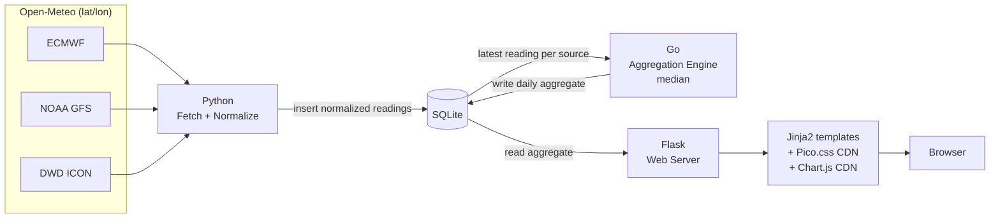

# multiWeatherApp — Project Research & Architecture Decisions

This document records the original idea, the architecture that came out of
it, and the reasoning behind each technology choice. Kept for future-me and
for anyone (recruiters included) looking at the reasoning behind the repo.

## 1. Original Plan

> Consolidate weather information from multiple sites/APIs (webscraping
> possibly included), normalize and store it, then compute a daily average
> (or another statistic — median was flagged as worth weighing) across
> sources to get a better week/month prediction. Show the result on a
> simple web view.

Stated constraints going in:
- Keep it simple, efficient, fast.
- Avoid `node_modules` — found it too heavy.
- Deploy self-hosted: own PC, or even a phone acting as a server. Speed
  matters because of this.
- Would like to use **C** somewhere — not because the project needs it,
  but for personal enjoyment and as a public GitHub portfolio piece. A
  "forced but wanted" constraint, explicitly flagged as such.
- Open to suggestions on the rest of the stack (candidates floated: C/Go
  backend, Python frontend, Java backend, Python both sides, plain
  JS/HTML frontend).

## 2. Prior Art

Checked whether this has been built before (2026-09-13 web research).
Short answer: yes, multiple times, at very different scales.

| Project | Scale | Approach | Stack |
|---|---|---|---|
| [Consensus_Weather](https://github.com/Szebastian31/Consensus_Weather) | Small | Flat average of 7 national models via Open-Meteo | HTML/JS, no backend, no storage |
| [wx-aggregator](https://github.com/leizmonk/wx-aggregator) | Small | Flat average by ZIP | JS |
| [weather-ensemble-forecaster](https://github.com/Zephyr-Howson/weather-ensemble-forecaster) | Medium | Weights each source by `1 / recent mean absolute error`, reweighted nightly from tracked accuracy | Python, SQLite, scikit-learn, GitHub Actions/Pages |
| [weather-project](https://github.com/aleksgain/weather-project) | Medium | Weighted-median + MAD outlier rejection before averaging; severity-aware voting for conditions; confidence score from source agreement | React, client-side only |
| [open-local-weather](https://github.com/dissent00/open-local-weather) | Large (~476 commits) | Multi-model synthesis, per-lead-time accuracy tracking, self-improving verification loop, air quality/METAR, LLM integration | Python, Dart, git-as-database, serverless on GitHub Actions/Pages |

### Lessons taken from these

1. **Average vs. median — resolved.** Three independent projects hit the
   same problem (a flat mean is fragile when one source misbehaves) and
   solved it three different ways: median, MAD-based outlier rejection,
   or accuracy-based weighting. Decision: **start with median** for v1 —
   robust to outliers by construction, needs no historical data, trivial
   to implement in Go. Revisit accuracy-weighted blending
   (`weather-ensemble-forecaster`'s approach) as a v2 once enough history
   exists to know which sources are actually more accurate at this
   location.
2. **Add a confidence/agreement figure alongside the aggregate.** Cheap —
   it's the spread/std-dev already computed mid-aggregation — and directly
   serves the original goal ("better idea of the prediction"), not just
   the number itself. Seen in `weather-project`'s confidence score and
   `open-local-weather`'s per-lead-time accuracy tracking.
3. **Mistake to avoid**: `weather-project` calls weather APIs directly
   from browser JS, exposing API keys client-side. Not applicable here —
   this project's fetch step runs server-side in Python by design — but
   worth naming so it stays a deliberate property, not an accident.
4. **`open-local-weather` is the "very big project" exception** — not a
   reason to second-guess this project's own shape, just a source of a
   couple of ideas (per-lead-time accuracy tracking, in particular) worth
   remembering if this project grows later.
5. No prior project found combines a compiled aggregator with a
   separate-language fetcher the way this one plans to (most are
   single-language throughout) — the pipeline shape here isn't a
   duplicate of something existing.

## 3. Proposed Architecture



Pipeline in words:
0. **Trigger — a scheduled job, once daily.** A cron
   job (or platform equivalent — Task Scheduler / Termux alternative,
   whatever the deploy target needs) runs fetch + aggregate at a fixed
   time each day, independent of whether anyone visits the page. Chosen
   over on-demand for two reasons: simpler to reason about and maintain,
   and it gives every day's fetch a *consistent* wall-clock time —
   fetching only when a visitor happens to show up would scatter
   `fetched_at` across the day, adding noise to Phase 2's lead-time
   accuracy analysis (comparing "how good was the day+3 forecast" only
   works cleanly if every day's fetch lands at a comparable point in the
   day).
1. **Fetch** (Python, run by the scheduled job) queries Open-Meteo for
   the target lat/lon (read from a config file) with `models=` set to
   the 3 v1 sources (ECMWF, NOAA GFS, DWD ICON), normalizes the response
   into the common schema, and inserts rows into SQLite.
2. **Aggregate** (Go, invoked by the same job right after fetch) reads
   each source's *most recent* reading for the day (not every historical
   fetch — see Database Schema notes), computes the cross-source median,
   and **upserts the aggregate for every `valid_date` in that fetch's
   7-day window**, not just today — otherwise a distant day's forecast
   would never update as it gets closer, defeating the point of daily
   refetching. The same job also prunes data past the retention window
   (see Database Schema notes) before it exits.
3. **Serve** (Flask) reads the aggregate from SQLite and renders it
   server-side; the browser gets a plain HTML page with a Chart.js trend
   graph, no JS build step involved. Flask never fetches or aggregates —
   purely reads what the scheduled job already computed.

SQLite sits in the middle as the shared interface between the two
compiled/interpreted halves of the pipeline — no bespoke file format or
IPC needed between Python and Go.

## 4. Database Schema

Key fields (must survive normalization intact): **temperature, date,
latitude, longitude, humidity**. Everything else is a bonus field, useful
but not load-bearing for the median.

Four tables: two lookups (`sources`, `conditions`) so repeating text
doesn't get duplicated per row, one fact table (`readings`) for raw
per-source data, one derived table (`aggregates`) for the daily median.
Wind speed/direction are plain numeric columns, not a lookup table — they
aren't categorical. Lat/lon stay inline on `readings`/`aggregates` rather
than a separate `locations` table — this is a single (or few) fixed-
location deployment, so normalizing them out would just cost a join for
no benefit yet.

```sql
CREATE TABLE sources (
    id       INTEGER PRIMARY KEY,
    provider TEXT NOT NULL,        -- e.g. 'open-meteo'
    name     TEXT NOT NULL UNIQUE  -- e.g. 'ecmwf', 'gfs', 'icon'
);

CREATE TABLE conditions (
    id   INTEGER PRIMARY KEY,
    code TEXT NOT NULL UNIQUE      -- 'clear', 'rain', 'overcast', 'snow', 'fog', 'thunderstorm'
);

CREATE TABLE readings (
    id                        INTEGER PRIMARY KEY,
    source_id                 INTEGER NOT NULL REFERENCES sources(id),
    latitude                  REAL NOT NULL,
    longitude                 REAL NOT NULL,
    valid_date                TEXT NOT NULL,  -- ISO-8601 date this forecast is FOR
    fetched_at                TEXT NOT NULL,  -- ISO-8601 timestamp of the API call
    temperature               REAL,  -- critical
    humidity                  REAL,  -- critical
    dew_point                 REAL,
    precipitation_probability REAL,
    wind_speed                REAL,
    wind_direction            REAL,
    condition_id              INTEGER REFERENCES conditions(id),
    UNIQUE (source_id, valid_date, fetched_at)
);

CREATE TABLE aggregates (
    id                        INTEGER PRIMARY KEY,
    latitude                  REAL NOT NULL,
    longitude                 REAL NOT NULL,
    valid_date                TEXT NOT NULL,
    temperature               REAL,
    humidity                  REAL,
    dew_point                 REAL,
    precipitation_probability REAL,
    source_count              INTEGER NOT NULL,
    computed_at               TEXT NOT NULL,
    UNIQUE (latitude, longitude, valid_date)
);
```

Notes:
- `valid_date` vs. `fetched_at` on `readings` is the one field worth
  getting right now rather than retrofitting later: without it, Phase 2
  accuracy-by-lead-time tracking (§6) has no way to tell a forecast made
  5 days out from one made 1 day out for the same `valid_date`.
- Dates/timestamps stored as ISO-8601 `TEXT` — SQLite has no native date
  type, and TEXT ISO-8601 sorts correctly and reads cleanly from both
  Python and Go.
- `sources` is also where a future accuracy weight (§6's
  accuracy-weighted blending) would live as an added column — not
  included now, kept out until that's actually built.
- Confidence/agreement metric (§7 open question) intentionally has no
  column yet in `aggregates` — add it when that question is resolved,
  not speculatively now.
- **Aggregation must use only the latest `fetched_at` per source per
  `valid_date`.** Multiple fetches can accumulate for the same target
  date (kept deliberately, for Phase 2 lead-time tracking) — computing
  today's median must use each source's most recent reading only, or one
  model's opinion gets counted multiple times.
- **Missing/null source handling (v1 default, easy to tune later)**:
  exclude a source's value from a field's median if that field is null;
  skip writing an aggregate entirely for a day if fewer than 2 of the 3
  sources have a valid value for a critical field.
- **Timestamps (`fetched_at`, `computed_at`) are UTC.** `valid_date` is
  the *local calendar date at the configured location*, not the UTC
  date — must be computed from the location's own timezone, since a
  UTC-day boundary can land on the wrong local date.
- **Units are metric only** (Celsius, km/h, mm) — Open-Meteo's default;
  never pass its imperial unit parameters.
- **Retention: 5 years, then deleted.** Growth is trivial on its own
  (~21 `readings` rows/day ≈ 1.5 MB/year; `aggregates` ~55 KB/year — a
  decade would be well under 50 MB, no problem for SQLite), so 5 years
  isn't a storage necessity, it's a deliberate ceiling set now while the
  codebase is small and familiar, rather than retrofitted later as
  unfamiliar code. Generous enough to not conflict with Phase 2's
  accuracy tracking, which reaches useful sample sizes long before 5
  years. Implementation: a cheap `DELETE WHERE valid_date < 5 years ago`
  on both tables, tacked onto the end of the same daily job — no separate
  scheduled process needed for it.

## 5. Technology Decisions

Each section: options considered → pros/cons → decision.

### 5.1 Fetch & Normalize Layer

| Option | Pros | Cons |
|---|---|---|
| **Python** | Best HTTP/JSON ergonomics; fast to iterate when an API changes or misbehaves | Needs an interpreter; slightly heavier than a compiled binary |
| C | Fast, no interpreter | HTTP needs libcurl, JSON needs cJSON — much more boilerplate for volatile, frequently-changing integration code |
| Java | Mature HTTP clients | JVM startup/memory overhead conflicts with the self-hosted/low-power goal |

**Decision: Python.** This layer talks to flaky, changing external APIs —
that's exactly where a scripting language's iteration speed matters more
than runtime overhead, especially since it only runs periodically, not
continuously.

**Source for v1: Open-Meteo only, 3 named models, no scraping, no
site-discovery step.** None of the prior-art projects in §2 needed web
scraping. Open-Meteo takes a lat/lon and can return several independent
national models in one call via its `models=` parameter (the default
endpoint otherwise returns one pre-blended value, not separate models);
v1 uses **ECMWF, NOAA GFS, DWD ICON** — a deliberately small starting set,
easy to widen later since `sources` is already a lookup table. This
already satisfies "multiple sources" as a genuine multi-model ensemble,
without needing to discover nearby weather sites or integrate different
auth/rate-limit schemes per provider. A second, distinct-provider API
(e.g. OpenWeatherMap) can be added later for true cross-company
diversity; scraping is dropped from scope entirely.

### 5.2 Aggregation Engine

| Option | Pros | Cons |
|---|---|---|
| C | SQLite amalgamation compiles straight in, zero-dependency static binary; genuinely enjoyed writing it | More manual; not the better career bet |
| **Go** | Easiest learning curve of the three; single static binary; pure-Go SQLite drivers avoid needing a C toolchain on the target device; use cases (backend/cloud/infra) map onto the majority of general software-engineering job postings, unlike C's narrower embedded/systems niche | Garbage-collected |
| Rust | Highest current recruiter buzz; memory-safe; single static binary | Steepest learning curve of the three; would be learning it from scratch for this project |
| C++ | — | Ruled out early — unfamiliar, and the extra complexity over C isn't needed for this job |

**Decision: Go** Chosen because of easy learning curve, recent popularity and good performance in backend, as well as efficient, perhaps not as efficient as C, but for this task, Go is better suited and compensates in implementation, libraries, the disadvantage it has in speed over C

### 5.3 Storage

| Option | Pros | Cons |
|---|---|---|
| **SQLite** | Zero-config, single file, transactional, has both Python and Go bindings — doubles as the interface between those two components with no extra format needed | Not built for heavy concurrent writes (irrelevant at this data volume) |
| Postgres/MySQL | Robust, multi-user | Requires running a separate DB server process — contradicts "simple, self-hosted on a phone" |
| Flat files (CSV/JSON) | Dead simple | No real querying, manual concurrency/indexing as data grows |

**Decision: SQLite.** Chosen because of size, perfect for this type of small concurrent writes and future data analysis

### 5.4 Web Serving

| Option | Pros | Cons |
|---|---|---|
| **Flask** | Lightweight; Jinja2 templating built in; minimal boilerplate; huge amount of documentation/examples | Still a `pip install`, but a light one |
| Plain `http.server` | Zero dependencies | Hand-rolling routing/templating that Flask gives for free, for no real benefit |
| Django | Batteries included | Overkill for a single-page dashboard |
| Node/Express | Popular | Drags in `node_modules` — explicitly rejected constraint |

**Decision: Flask.** Chosen because of its simplicity and already familiarity with the language and framework

### 5.5 Frontend

| Option | Pros | Cons |
|---|---|---|
| **Flask/Jinja2 + Pico.css (CDN) + Chart.js (CDN)** | No `node_modules`, no build step; styling and charting handled by drop-in libraries; most view logic stays in Python (comfortable territory) rather than hand-written JS (weakest skill area) | Less powerful than a full SPA framework — acceptable, the app doesn't need to be one |
| React/Vue | Huge ecosystem, component model | Requires `node_modules` + a build step — explicitly rejected constraint |
| Hand-rolled HTML/CSS/JS, no libraries | Zero dependencies | Frontend is the weakest skill area; would mean fighting CSS instead of building the feature |

**Decision: Flask/Jinja2 + Pico.css + Chart.js, plain page reload for v1.**
HTMX (still CDN-only, no build step) is the natural next step if live
refresh without reload is wanted later — deliberately deferred, not
needed for a first version.

## 6. Phase 2 (future)

- **WhatsApp notification**: send the daily aggregate as a WhatsApp
  message before the next day, so the forecast doesn't need to be
  checked manually. Not scoped yet.
- **Accuracy tracking**: compare each source's prediction against actual
  observed weather to know which sources are more reliable (feeds the
  accuracy-weighted blending idea in §5.2). Ground-truth candidates:
  Open-Meteo Historical Weather API (reanalysis, worldwide, no key —
  likely default) or Meteostat (raw station data, 500 req/month free).
  Not scoped yet.

## 7. Open Questions / Deferred Decisions

- ~~Average vs. median~~ — resolved above: median for v1, accuracy-weighted
  blending as a possible v2.
- ~~Which specific weather APIs/sources to use~~ — resolved: Open-Meteo
  only for v1 (§5.1); a second distinct provider is a possible later add.
- ~~Whether webscraping is needed~~ — resolved: no, dropped from scope
  (§5.1).
- Whether to add a confidence/agreement metric in v1 or defer it.

## 8. Decision Log

- **2026-09-13** — Architecture locked as described above (see
  [AGENTS.md](AGENTS.md) for the operational summary agents should read).
- **2026-09-13** — Prior-art research completed; median chosen over
  average for v1 aggregation statistic.
- **2026-09-13** — Aggregation engine switched from C to Go after
  job-market research (§5.2).
- **2026-09-13** — v1 fetch source narrowed to Open-Meteo only; scraping
  and site-discovery dropped from scope (§5.1) — no prior-art project
  needed scraping, and Open-Meteo's lat/lon multi-model coverage removes
  the need to discover nearby sites.
- **2026-09-13** — Database schema drafted (§4): `sources`, `conditions`,
  `readings`, `aggregates`. Added `precipitation_probability` as a
  non-critical bonus field.
- **2026-09-13** — v1 sources locked to 3 named models: ECMWF, NOAA GFS,
  DWD ICON.
- **2026-09-13** — Fetch/aggregate switched from cron to on-demand,
  cache-through-SQLite, triggered by Flask on page request (§3) — no
  scheduler process needed for v1.
- **2026-09-13** — Location config via a config file (not browser
  geolocation).
- **2026-09-13** — v1 null-handling default set (§4): exclude null
  fields per source; skip the day's aggregate if fewer than 2 of 3
  sources have a valid value.
- **2026-09-13** — Timestamps UTC, `valid_date` is the location's local
  calendar date; units metric-only (§4).
- **2026-09-13** — Aggregator upserts all 7 days per fetch, not just
  today (§3).
- **2026-09-13** — Reverted on-demand back to a scheduled job (cron or
  platform equivalent), run once daily (§3): simpler to maintain, and
  gives every day's fetch a consistent wall-clock time, which matters
  for Phase 2's lead-time accuracy analysis. Flask only ever reads.
- **2026-09-13** — Retention set to 5 years, then deleted (§4) —
  established now rather than retrofitted later; storage growth alone
  didn't require it, but the ceiling is worth having on principle.
